# Full accrual Accounting Stage 1 — DEV structural design

**Status: APPLIED to local `arya_tarray_dev` on 2026-11-03 (Asia/Jakarta).**
The database now has 56 tables. The
[SQL migration](../database/accounting-full-accrual-stage1.mysql.sql) was run
once with the local MySQL administrator after a verified fresh backup. The
Prisma schema now describes the resulting Accounting tables and relations.
The production database was neither queried nor changed.

## Baseline and design decision

Read-only inventory found 2 rows in `arya_accounting_account` (codes `1110`
and `4110`), 0 journals, and 0 journal lines. The three existing Accounting
tables remain. Their primary keys and existing source/audit relationships are
valuable. The account type restriction and mandatory bank references are
extended, since they otherwise exclude liabilities, net assets, expenses and
nonbank accrual journals. No table is dropped or recreated, and no existing
rows are deleted. There is no bulk chart-of-accounts seed.

The implemented layout uses `arya_accounting_journal` and
`arya_accounting_journal_line` as the sole posted ledger. Every report balance
comes from those rows. AP/AR allocations, schedules, asset runs, restrictions,
and bank matches store operational evidence; they are not duplicate GL or
trial-balance tables. `arya_accounting_account` is hierarchical, supports
header/posting accounts, five account types, statement classification and
contra flags. Restrictions distinguish donor purpose/time restrictions,
internal designations, and conditional receipts carried as liabilities.

## Table catalog

All new tables have UUID `CHAR(36)` primary keys, InnoDB, `utf8mb4`, restricted
deletes, relevant unique/idempotency keys, checks and foreign-key indexes.
Exact keys, column types and CHECK definitions are in the SQL patch.

| Table | Purpose and principal references | Key integrity |
| --- | --- | --- |
| `arya_accounting_fiscal_year` | Fiscal boundaries, status and closer → User | unique year code; date/status checks |
| `arya_accounting_period` | Period within fiscal year; optional closing journal → Journal | unique year/number and code; date/status checks |
| `arya_accounting_counterparty` | AP vendor or AR debtor; optional → Member | unique code/member; type check |
| `arya_accounting_fund` | Financial fund dimension; optional → Account/Campaign | unique code; class/status checks |
| `arya_accounting_fund_restriction` | Donor purpose/time evidence → Fund/Member | unique fund/source and restriction/fund pair; kind/date checks |
| `arya_accounting_fund_designation` | Management-designated use → Fund/User | unique approval reference; status check |
| `arya_accounting_opening_batch` | Opening-balance provenance → FiscalYear/Journal/User | unique batch reference and journal |
| `arya_accounting_document` | AP invoice or AR document → Counterparty/Journal/User | unique kind/counterparty/number, source and recognition journal |
| `arya_accounting_document_line` | Document detail → Document/Account/Fund/Campaign | unique document/line; positive amount |
| `arya_accounting_settlement` | Payment or receipt → Counterparty/BankTransaction/Journal/User | unique kind/reference and posting journal; positive amount |
| `arya_accounting_settlement_allocation` | Many-to-many partial settlement → Document/Settlement | unique pair; composite FKs require same kind and counterparty |
| `arya_accounting_document_adjustment` | Auditable increase/decrease of AP or AR → Document/Journal/User | unique adjustment reference and journal; positive amount |
| `arya_accounting_schedule` | Accrual, prepayment or deferral plan → JournalLine/Document/Accounts/User | unique reference; kind/date/amount checks |
| `arya_accounting_schedule_period` | Periodic planned recognition → Schedule/Period/Journal | unique schedule/period; positive amount |
| `arya_accounting_asset_category` | Account defaults and depreciation policy → Accounts | unique category code; useful-life/method checks |
| `arya_accounting_fixed_asset` | Asset register and disposal evidence → Category/JournalLine/Journal/Campaign | unique asset number/source/disposal; cost/life/date checks |
| `arya_accounting_depreciation_run` | Period run → Period/Journal/User | unique run reference and posting journal |
| `arya_accounting_depreciation_run_asset` | Asset within run → Run/Asset/JournalLines | unique run/asset; paired line references |
| `arya_accounting_fund_release` | Restricted-net-assets release → Restriction/Journal/User | unique release reference and journal |
| `arya_accounting_bank_reconciliation` | Statement review → BankAccount/Period/Upload/User | unique reconciliation reference; status check |
| `arya_accounting_bank_reconciliation_match` | Partial bank/GL match → Reconciliation/BankTransaction/JournalLine/User | unique transaction/line pair; positive amount |

**Table count: 35 before, 56 after** (21 new). Three existing Accounting tables
were extended; none were dropped. The original account codes remain.

## ERD

```mermaid
erDiagram
  ACCOUNTING_ACCOUNT ||--o{ ACCOUNTING_ACCOUNT : parent
  ACCOUNTING_ACCOUNT ||--o{ ACCOUNTING_JOURNAL_LINE : posted_to
  ACCOUNTING_JOURNAL ||--|{ ACCOUNTING_JOURNAL_LINE : contains
  ACCOUNTING_JOURNAL ||--o{ ACCOUNTING_JOURNAL : reversal
  BANK_TRANSACTION ||--o{ ACCOUNTING_JOURNAL : source
  BANK_ACCOUNT ||--o{ ACCOUNTING_JOURNAL_LINE : source_snapshot
  MEMBER ||--o{ ACCOUNTING_JOURNAL_LINE : donor_snapshot
  EVENT_CAMPAIGN ||--o{ ACCOUNTING_JOURNAL_LINE : campaign_snapshot
  ACCOUNTING_FISCAL_YEAR ||--o{ ACCOUNTING_PERIOD : contains
  ACCOUNTING_FISCAL_YEAR ||--o{ ACCOUNTING_OPENING_BATCH : opens
  ACCOUNTING_PERIOD ||--o{ ACCOUNTING_JOURNAL : assigns
  ACCOUNTING_JOURNAL ||--o| ACCOUNTING_OPENING_BATCH : evidence
  MEMBER ||--o| ACCOUNTING_COUNTERPARTY : maps
  MEMBER ||--o{ ACCOUNTING_FUND_RESTRICTION : donor
  EVENT_CAMPAIGN ||--o{ ACCOUNTING_FUND : tags
  ACCOUNTING_FUND ||--o{ ACCOUNTING_FUND_RESTRICTION : governs
  ACCOUNTING_FUND ||--o{ ACCOUNTING_FUND_DESIGNATION : designates
  ACCOUNTING_FUND ||--o{ ACCOUNTING_JOURNAL_LINE : dimension
  ACCOUNTING_FUND_RESTRICTION ||--o{ ACCOUNTING_JOURNAL_LINE : dimension
  ACCOUNTING_FUND_RESTRICTION ||--o{ ACCOUNTING_FUND_RELEASE : releases
  ACCOUNTING_ACCOUNT ||--o{ ACCOUNTING_FUND : balance_mapping
  ACCOUNTING_JOURNAL ||--o{ ACCOUNTING_FUND_RELEASE : evidence
  ACCOUNTING_JOURNAL ||--o{ ACCOUNTING_PERIOD : closing_evidence
  ACCOUNTING_COUNTERPARTY ||--o{ ACCOUNTING_DOCUMENT : owes
  ACCOUNTING_DOCUMENT ||--|{ ACCOUNTING_DOCUMENT_LINE : contains
  ACCOUNTING_ACCOUNT ||--o{ ACCOUNTING_DOCUMENT_LINE : classifies
  ACCOUNTING_FUND ||--o{ ACCOUNTING_DOCUMENT_LINE : dimensions
  EVENT_CAMPAIGN ||--o{ ACCOUNTING_DOCUMENT_LINE : tags
  ACCOUNTING_COUNTERPARTY ||--o{ ACCOUNTING_SETTLEMENT : pays
  ACCOUNTING_DOCUMENT ||--o{ ACCOUNTING_SETTLEMENT_ALLOCATION : allocated
  ACCOUNTING_DOCUMENT ||--o{ ACCOUNTING_DOCUMENT_ADJUSTMENT : adjusted
  ACCOUNTING_JOURNAL ||--o{ ACCOUNTING_DOCUMENT : recognition
  ACCOUNTING_JOURNAL ||--o{ ACCOUNTING_DOCUMENT_ADJUSTMENT : adjustment
  ACCOUNTING_JOURNAL ||--o{ ACCOUNTING_SETTLEMENT : settlement
  ACCOUNTING_SETTLEMENT ||--o{ ACCOUNTING_SETTLEMENT_ALLOCATION : allocated
  BANK_TRANSACTION ||--o{ ACCOUNTING_SETTLEMENT : bank_evidence
  ACCOUNTING_JOURNAL_LINE ||--o{ ACCOUNTING_SCHEDULE : source
  ACCOUNTING_DOCUMENT ||--o{ ACCOUNTING_SCHEDULE : supports
  ACCOUNTING_ACCOUNT ||--o{ ACCOUNTING_SCHEDULE : recognition_or_balance
  ACCOUNTING_SCHEDULE ||--|{ ACCOUNTING_SCHEDULE_PERIOD : plans
  ACCOUNTING_PERIOD ||--o{ ACCOUNTING_SCHEDULE_PERIOD : dates
  ACCOUNTING_JOURNAL ||--o{ ACCOUNTING_SCHEDULE_PERIOD : recognition
  ACCOUNTING_ASSET_CATEGORY ||--o{ ACCOUNTING_FIXED_ASSET : categorizes
  ACCOUNTING_ACCOUNT ||--o{ ACCOUNTING_ASSET_CATEGORY : asset_accum_expense
  ACCOUNTING_JOURNAL_LINE ||--o| ACCOUNTING_FIXED_ASSET : acquired_by
  ACCOUNTING_JOURNAL ||--o{ ACCOUNTING_FIXED_ASSET : disposed_by
  ACCOUNTING_PERIOD ||--o{ ACCOUNTING_DEPRECIATION_RUN : runs
  ACCOUNTING_DEPRECIATION_RUN ||--o{ ACCOUNTING_DEPRECIATION_RUN_ASSET : includes
  ACCOUNTING_JOURNAL ||--o{ ACCOUNTING_DEPRECIATION_RUN : posts
  ACCOUNTING_JOURNAL_LINE ||--o{ ACCOUNTING_DEPRECIATION_RUN_ASSET : debit_credit_evidence
  ACCOUNTING_FIXED_ASSET ||--o{ ACCOUNTING_DEPRECIATION_RUN_ASSET : depreciates
  EVENT_CAMPAIGN ||--o{ ACCOUNTING_FIXED_ASSET : tags
  BANK_ACCOUNT ||--o{ ACCOUNTING_BANK_RECONCILIATION : reviews
  BANK_STATEMENT_UPLOAD ||--o{ ACCOUNTING_BANK_RECONCILIATION : evidence
  ACCOUNTING_BANK_RECONCILIATION ||--o{ ACCOUNTING_BANK_RECONCILIATION_MATCH : matches
  BANK_TRANSACTION ||--o{ ACCOUNTING_BANK_RECONCILIATION_MATCH : statement_side
  ACCOUNTING_JOURNAL_LINE ||--o{ ACCOUNTING_BANK_RECONCILIATION_MATCH : ledger_side
```

Existing Event Code, Member Identity, Reconciliation Correction and User links
to the three Accounting tables remain as defined in the current schema.
Operational campaign wallet and Member ledgers remain separate and unchanged.

## Constraints requiring the future posting layer

MySQL row CHECKs and FKs cannot prove a journal's total debits equal credits,
that every line posts to an active posting account, or that journal date falls
within an OPEN period. They cannot cap the aggregate allocation to document
amount, aggregate bank matches to both sides, ensure a bank match uses the
reconciliation's account, or prevent overlapping period ranges. Stage 2 must
enforce those rules transactionally and preserve append-only posted financial
history. The schema's status fields alone do not implement period locks or
reversals. Final account mapping and nonprofit reporting policy need accountant
review; no report generator is delivered in Stage 1.

## Application and Prisma compatibility

The patch preserves existing columns/keys and makes bank references nullable.
The Prisma schema now models all 21 new tables, 71 new physical FK relations,
and the altered existing Accounting models. `npx prisma validate`,
`npx prisma generate`, and `npx tsc --noEmit -p tsconfig.json` pass after the
Phase 1 compatibility fix. Phase 1 reclassification now requires complete
original bank snapshots; incomplete evidence is rejected for posting and
flagged for review in preview. Journal detail handles a nullable bank source,
and the monthly read model types a nullable bank label correctly. The 20 safe
Accounting unit tests and read-only DEV preflight pass. Stage 2 posting rules
for new nonbank/AP/AR/fund workflows are still not implemented.

## Migration and verification record

1. The administrator session reported local host `LAPTOP-133EO855`, port
   `3306`, and `DATABASE() = arya_tarray_dev`; its grants included the needed
   DDL and export privileges. Baseline: 35 tables, 2 accounts, 0 journals and
   0 lines. Account codes were `1110` and `4110`.
2. A fresh `mysqldump` used a consistent transaction and included routines,
   triggers and events. The archive is
   `C:/Users/Frydo/Downloads/arya_tarray_dev_pre_full_accrual_20261102T181140Z.sql.gz`.
   It is 9,952 bytes, includes 35 `CREATE TABLE` definitions and a completion
   marker, and passed a decompression SHA-256 comparison with the original SQL.
   Archive SHA-256:
   `768E72122BF51E9838F09199F50480DD3B34EF43D6D34E1293B5B356D2716C1B`.
3. The patch completed without MySQL error. Postflight: 56 base tables,
   including 24 Accounting tables; all 35 original table names and all 21 new
   names are present. Accounting metadata reports 24 primary keys, 82 foreign
   keys, 44 unique constraints and 60 CHECK constraints. Every named constraint
   (128) and index (95) in the patch is present. All Accounting tables use
   InnoDB and `utf8mb4` collation. Account codes and row counts remained
   `1110`, `4110`; 2 accounts, 0 journals, 0 lines.
4. MySQL DDL implicitly commits. If a future repair is needed, do not rerun
   this non-idempotent patch. Inventory actual objects and prepare a reviewed
   forward repair or restore the verified DEV backup under a controlled
   change. Do not reset or drop unrelated tables.

The post-migration full backup is
`C:/Users/Frydo/Downloads/arya_tarray_dev_post_full_accrual_20261102T182812Z.sql.gz`
(14,761 bytes; SHA-256
`C12B508B138191222D24B537503D28D1EABFADD7A470E45128714860E8B7543D`).
The schema-only audit backup is
`C:/Users/Frydo/Downloads/arya_tarray_dev_post_full_accrual_schema_only_20261102T182837Z.sql`
(124,265 bytes; SHA-256
`F289DD78B94CC04FCEDDAFF1F96C7CA255261027274ACB7018C9D26C2A41FDA0`).
Both contain definitions for 56 tables. The full archive passed a decompression
hash comparison; schema-only contains no data statements or `DEFINER` clauses.

The production presentation database is outside this change and must not be
queried, migrated or used for verification.
